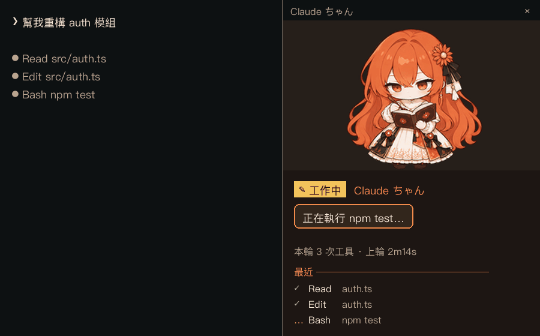
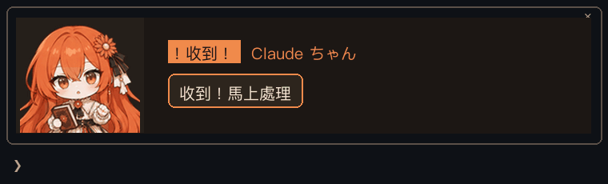
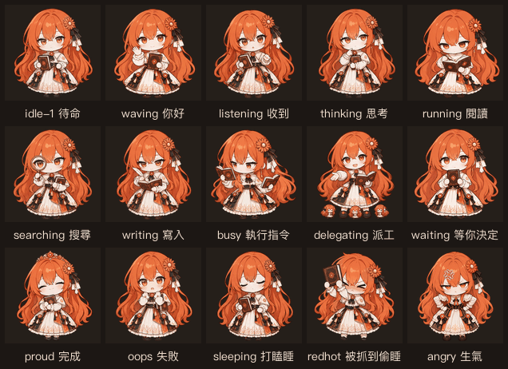

# Claude ちゃん ターミナル・コンパニオン（claudechan-chibi）

<p align="center"><a href="README.md">English</a> · <a href="README.zh-TW.md">繁體中文</a> · <b>日本語</b></p>

**現在のバージョン：0.5.7**（2026-11-09）

ちびキャラの Claude ちゃんが Claude Code のターミナル画面に住みつきます。Claude がしていることに合わせてアニメーションが変わります：考える、探す、ファイルを書く、コマンドを実行する、助手を送り出す、承認を待つ、失敗する、完了する……。何もないときはポーズを変えたり、鼻歌を歌ったり、あくびをして居眠りしたりします。絵をクリックすると反応し、連打すると怒ります。
横に広い画面では右側のペインに座り、狭い画面では入力欄の上に立ちます。

> mod の画面上の文字（状態ラベル、吹き出し、`/chibi` のメッセージ）は繁体字中国語です。この README では必要に応じて日本語訳を添えています。

<p align="center">
  <br>
  <sub>広い画面：会話の右側に固定されるペイン。ツールごとにポーズが変わります：読む → 書く → コマンド実行（イメージ）</sub>
</p>

<p align="center">
  <br>
  <sub>狭い画面：入力欄の上のペイン。上半身だけを表示：了解 → 検索 → 書き込み → 完了（イメージ）</sub>
</p>

<details>
<summary><b>主なアニメーション</b></summary>

<p align="center"></p>

<p align="center"><sub>どれも mod 実際のテンポで再生しています。全一覧は下の「イベントとアニメーション」を参照</sub></p>

</details>

> 上の画像は mod のレイアウトと配色で描いたイメージです（画像モード）。実際の見た目はターミナルとウィンドウの大きさで変わります。

絵柄は 2 セット（smooth / classic）あり、それぞれ基本の動きを持つほか、30 種あまりの共通アクションを共有します。どちらも髪色・頭身・立ち位置を揃えてあります。描画方法は 2 通りで、自動で選ばれます：

| 描画方法 | ターミナル | 画質 |
|---|---|---|
| **画像**（Image） | Ghostty、kitty、iTerm2 3.5+ | 元の PNG のピクセル、最も鮮明 |
| **文字**（Raster） | その他のトゥルーカラー対応ターミナル（Warp、Windows Terminal、WezTerm…） | 1 セルで 2×2 ピクセルを四分割ブロック文字 `▘▝▖▗▚▞…` で表現。多少の劣化は避けられません |

---

## 必要なもの

| 項目 | 説明 |
|---|---|
| Claude Code | mods（function hooks）対応版。2.1.316 で開発・テスト |
| ターミナル | 24-bit トゥルーカラー対応（Warp、Windows Terminal、iTerm2、WezTerm、Ghostty、kitty など） |
| フォント | 四分割ブロック文字 `▘▝▖▗▚▞▛▜▙▟` が正しく表示できるもの（Menlo、SF Mono、Cascadia、JetBrains Mono など） |
| OS | Windows / macOS / Linux（インストールスクリプトは `install.ps1` / `install.sh`） |

使う側のマシンに Python や Node は**不要**です。フレームは変換済みで、文字版は `plugin/hooks/frames-*.ts`、画像は `plugin/assets/` にあります。

---

## インストール

### GitHub から（いちばん簡単）

Claude Code のプロンプトで：

```
/plugin install claudechan-chibi --marketplace kzger/claudechan-chibi
```

またはシェルで：

```bash
claude plugin install claudechan-chibi --marketplace kzger/claudechan-chibi
```

`Add marketplace?` には `y`、user scope を選んで Enter。デスクトップアプリ（`/plugin` が使えない場合）：プロンプト横の **+** → Plugins → Add marketplace で `kzger/claudechan-chibi` を入力し、Add plugin。

#### GitHub の新しいバージョンに更新する

```bash
claude plugin marketplace update chibi-local
claude plugin update claudechan-chibi@chibi-local
```

そのあと**起動中の** Claude Code で `/reload-plugins` を実行します。

回線が遅くて marketplace の更新がタイムアウトする場合は、`~/.claude/settings.json` で git の制限時間を延ばしてください：`"env": { "CLAUDE_CODE_PLUGIN_GIT_TIMEOUT_MS": "600000" }`。

#### 旧名 chibi-companion からのアップグレード（0.3.x 以前）

0.4.0 から mod とリポジトリの名前は `claudechan-chibi` になりました。名前が違うため `plugin update` では切り替わりません。古いものを削除して新しいものを入れてください：

```bash
claude plugin uninstall chibi-companion@chibi-local
claude plugin marketplace update chibi-local
claude plugin install claudechan-chibi@chibi-local
```

旧 GitHub URL `kzger/chibi-companion` は新しい URL に転送されます。設定（`/chibi` の表示方法・絵柄・描画方法）は名前ごとに保存されるので、改名後は既定値に戻ります。もう一度設定してください。`install.sh` / `install.ps1` でのインストールなら旧名は自動で削除されます。

> `/exit` して `claude` を開き直しても再読み込みされるとは限りません。Claude Code がバックグラウンドのデーモンとして動いている場合、開き直しは同じプロセスに `claude attach` するだけで、メモリ上は古い mod のままです。`/reload-plugins` なら確実です。

### ローカルフォルダから

### Windows

```powershell
cd <このフォルダ>
powershell -ExecutionPolicy Bypass -File .\install.ps1
```

### macOS / Linux / WSL

```bash
cd <このフォルダ>
bash install.sh
```

（zip で持ってきたファイルは実行権限が外れることがあるので、`bash install.sh` で実行するのが確実です。）

インストールスクリプトは次の 3 つを行います：

1. `.claude-plugin/`、`plugin/`、README、ATTRIBUTION を `~/.claude/local-marketplaces/claudechan-chibi/` にコピー
2. そのフォルダをローカル marketplace `chibi-local` として登録
3. `claude plugin install claudechan-chibi@chibi-local` を実行（既定は `user` scope で、すべてのプロジェクトに表示）

終わったら `claude` を再起動すると彼女が現れます。

| オプション | PowerShell | Bash |
|---|---|---|
| このプロジェクトだけに入れる | `-Scope project` | `--scope project` |
| 削除 | `-Uninstall` | `--uninstall` |
| 更新 | スクリプトをもう一度実行し、Claude Code で `/reload-plugins` | 同左 |

### スクリプトを使わずに手動で

```bash
claude plugin marketplace add <このフォルダの絶対パス>
claude plugin install claudechan-chibi@chibi-local
```

> この方法はフォルダを直接読むので、フォルダを削除・移動しないでください。

---

## 別のマシンへ移す

1. `claude-chibi-cli` フォルダごとコピー（または zip に）します。`tools/` はフレームを作り直すときだけ必要なので、置いていって構いません。
2. 新しいマシンで「インストール」の手順どおりスクリプトを実行します。
3. 設定（表示方法・絵柄）は各マシンの Claude Code store に保存されていて一緒には移りません。必要なら `/chibi` で設定し直してください。

---

## macOS

### 手順

1. Claude Code をインストール（済みなら不要）：`curl -fsSL https://claude.ai/install.sh | bash`、または `npm install -g @anthropic-ai/claude-code`
2. `claude-chibi-cli` フォルダを Mac にコピー（例：`~/claude-chibi-cli`）
3. インストール：
   ```bash
   cd ~/claude-chibi-cli
   bash install.sh
   ```
4. おすすめのターミナルで `claude` を開きます。絵が見えれば画像モードは正常です。`/chibi` で 原圖（画像）と 字元（文字）のどちらで描いているか分かります。

他のコンピュータから持ってきたファイルを初めて実行したときに「開発元を検証できません」と出たら、`xattr -dr com.apple.quarantine ~/claude-chibi-cli` を実行してください。

### おすすめのターミナル

| ターミナル | 描画方法 | おすすめ度 |
|---|---|---|
| **Ghostty**（https://ghostty.org） | 画像（kitty 画像プロトコル） | **第一候補**。無料・高速・標準対応で設定不要 |
| **kitty**（https://sw.kovidgoyal.net/kitty） | 画像 | とても良い。設定はすべて設定ファイルで |
| **iTerm2 3.5+** | 画像（Claude Code の fullscreen モードが必要、既定でオン） | 使えます。空白しか見えなければ `/chibi render cells` |
| WezTerm、Warp | 文字 | 使えますが、画質は Windows と同じ |
| Alacritty | 文字 | 使えます。Alacritty は画像プロトコルに非対応なので画像は出ません。起動時の判定の空白を省くため一度 `/chibi render cells` を実行するのがおすすめ。画像を出したいなら Ghostty が近い使い心地です（同じく GPU 描画・設定ファイル駆動） |
| 標準の「ターミナル」Terminal.app | 文字 | 非推奨：古い版は 24-bit カラー非対応で色がずれます |

### 画像／文字の切り替え

| コマンド | 効果 |
|---|---|
| `/chibi render auto` | 既定。描けるなら画像、無理なら自動で文字 |
| `/chibi render image` | 常に画像 |
| `/chibi render cells` | 常に文字（Alacritty ではこれがおすすめ。起動時の判定の空白が出ません） |

`/chibi` で実際の状態が見られます。例：「目前畫面 — 面板：原圖，上方列：原圖」（現在 — ペイン：画像、上部の列：画像）。設定は記憶され、次回も使われます。

### Ghostty + tmux（macOS）

tmux は画像を外側のターミナルへ「中継」するだけなので、外側のターミナル自身が画像を描ける必要があります：

| 組み合わせ | 画像 |
|---|---|
| Alacritty + tmux | ✗ 不可（Alacritty は画像非対応）。文字のみ |
| Ghostty + tmux | ✓ 可。下記の設定をしてください |
| Ghostty（tmux なし） | ✓ 可。設定不要 |

**1. インストール**

```bash
brew install --cask ghostty
brew install tmux        # 済みなら不要。tmux 3.3 以上が必要（tmux -V で確認）
```

**2. `~/.tmux.conf` に追加：**

```tmux
# Claude Code の画像を tmux 越しに Ghostty に描かせる（画像モードに必須）
set -g allow-passthrough on
set -g focus-events on

# トゥルーカラー（文字モードの色を正しくするのに必要）
set -g default-terminal "tmux-256color"
set -as terminal-features ",xterm-ghostty:RGB"
```

**3. 反映**：起動中の tmux サーバーは新しい設定を読まないので、丸ごと再起動します：

```bash
tmux kill-server   # すべての tmux セッションが閉じます。作業は先に保存を
tmux
```

**4. 確認**：tmux の中で `claude` を起動して `/chibi` を実行し、「面板：原圖」（ペイン：画像）と出れば成功です。字元（文字）と出る場合：

- `tmux show -g allow-passthrough` が `on` か
- `tmux -V` が 3.3 以上か
- 外側が本当に Ghostty か（tmux の外で `echo $TERM_PROGRAM` が `ghostty` か）

### Alacritty + tmux から Ghostty へ

tmux のセッション、detach、キー操作、`.tmux.conf` はそのまま使えます。外側のターミナルを替えて、手順 2 の設定を足すだけです。

tmux を使わないなら、Ghostty だけでも画面を分割できます：

| 操作 | Ghostty のショートカット |
|---|---|
| 左右に分割 | `Cmd+D` |
| 上下に分割 | `Cmd+Shift+D` |
| 前／次の分割へ | `Cmd+[` ／ `Cmd+]` |
| 今の分割を閉じる | `Cmd+W` |

違い：Ghostty の分割には tmux の **detach** がありません（ウィンドウを閉じるとプログラムも終了し、バックグラウンドに残して後でつなぎ直すことも、SSH 越しに同じセッションへ戻ることもできません）。tmux に慣れているなら **Ghostty + tmux** がおすすめです。

### tmux の中で色が灰色っぽい・右側のペインが出ない

Claude Code は tmux を検出すると 2 つのことをします。色を 256 色に落とす（暖かい茶色の背景が灰色になる）ことと、通常（非 fullscreen）の画面を使うことです。後者ではペインを右側に固定できず、入力欄の上にしか置けません。`~/.claude/settings.json` に次の `env` を加えて `claude` を開き直してください：

```json
{
  "env": {
    "CLAUDE_CODE_TMUX_TRUECOLOR": "1",
    "CLAUDE_CODE_NO_FLICKER": "1"
  }
}
```

前提として tmux 自体のトゥルーカラーが有効なこと（`set -ag terminal-overrides ",xterm-256color:RGB"`）。画面モードだけ切り替えるなら `/tui fullscreen` でも構いません。`/chibi` はこの 2 つの状況を検出すると知らせます。

### tmux の中でアニメーション中にカーソルや IME の変換がちらつく

Claude Code は毎フレームを「同期更新」で包みます（カーソルを隠す → 描く → カーソルを入力欄に戻す）。ターミナルが一度に描き切るので、カーソルの移動は見えません。ところが tmux は、外側のターミナルが同期更新に対応していると知っているときしかそれを伝えず、そうでなければカーソルの一歩一歩が描かれてしまいます。tmux の設定に追加してください（Alacritty 0.13+、Ghostty、kitty、WezTerm、iTerm2 が対応）：

```
set -as terminal-features ",xterm-256color:sync"
```

tmux は接続時に外側のターミナルの機能を判断するので、detach（`prefix` `d`）して `tmux attach` し直すか、`tmux kill-server` で再起動します。`tmux display -p '#{client_termfeatures}'` の一覧に `sync` があるか確認してください。

さらに **tmux サーバー 3.8 以上**が必要です。3.7 以前の tmux は自分で再描画するとき同期ブロックの外でカーソルを隠すため、`sync` があってもちらつきます。tmux をアップグレードしても古いサーバーは古い版のまま動き続けるので、`tmux kill-server` で再起動してください。`tmux display -p '#{version}'` で見えるのは**サーバー**の版です（`tmux -V` はプログラム自体の版）。

### herdr（tmux の代わりに）

[herdr](https://herdr.dev) はコーディングエージェント向けのターミナル多重化ツールで、tmux と同じく画面分割やバックグラウンドでのセッション保持ができます。Kitty 画像プロトコルを自分で解釈してから外側のターミナルに渡すので、画像モードでも **tmux のような画像切り替え時のちらつきがありません**。

ただし Claude Code は herdr の中では画像対応を検出できず（herdr はターミナル名を `libghostty` と報告し、Claude Code は `kitty` / `ghostty` しか認識しない）、文字モードになります。画像を出すには `~/.zshrc` に追加します：

```zsh
# Claude Code cannot detect image support inside herdr (it reports "libghostty"),
# but herdr renders Kitty graphics: let Claude Code draw pictures there only.
if [[ "$TERM_PROGRAM" == "herdr" ]]; then
  export CLAUDE_CODE_FORCE_TERMINAL_IMAGES=1
fi
```

- herdr のペインの中だけで有効です（herdr は `TERM_PROGRAM=herdr` を設定します）。この変数を `settings.json` に書くのは**やめてください**：画像非対応のターミナルや tmux の中では彼女が空白の塊になり、文字モードにも自動で戻りません。
- 外側のターミナルが画像を描けること（Ghostty、kitty など）。
- 追加したら**新しい**ペインを開くか、既存のペインで `exec zsh` を実行してください。herdr のバックグラウンドサービスがペインを保持するので、herdr を開き直しても古いペインは古い環境のままです。
- 確認：`echo $CLAUDE_CODE_FORCE_TERMINAL_IMAGES` が `1`、Claude Code で `/chibi render auto` を実行したあと `/chibi` が「面板：原圖」（ペイン：画像）を表示すること。

---

## 使い方

| コマンド | 働き |
|---|---|
| `/chibi` | 現在の設定と説明を表示 |
| `/chibi auto` | **既定**。広い画面（fullscreen かつ 110 桁以上）では右側に固定。狭い画面では入力欄の上の枠付きペインに。狭い画面の起動直後は Claude Code がペインを自動で置かせないため、まず上部の列を使い、最初のメッセージを送るとペインに切り替わります |
| `/chibi pane` | 常にペインを開く（手動で開けば幅に関係なく可） |
| `/chibi band` | 常に入力欄の上に置き、右側には固定しない。狭い画面（110 桁未満、または非 fullscreen）では `auto` と同じ右上に × のある枠。広い画面では Claude Code がペインを右側に固定してしまうので、上部の列（枠付き、右端に Claude Code 自前の `[-]`）を使います。起動直後やウィンドウが狭くなった直後もまず上部の列を使い、次のメッセージで × の枠に切り替わります |
| `/chibi off` | 絵を描かず、ステータスラインに文字だけ表示 |
| `/chibi set smooth` | smooth 絵柄（既定。隣り合うフレームの差が小さく、縮小してもちらつきにくい） |
| `/chibi set classic` | classic 絵柄（表情が豊か。例：手を振るとき口を開けて笑う） |
| `/chibi render auto` | **既定**。描けるなら画像、ターミナルが非対応なら自動で文字 |
| `/chibi render image` | 常に画像 |
| `/chibi render cells` | 常に文字 |

設定は記憶され、次回も使われます。

### 画面の配置

**広い画面**：右側のペイン（fullscreen モードでは会話の横に固定）

```
┌─ chat ───────────────────────────┬─ Claude ちゃん ──────────────┐
│ > auth モジュールを整理して        │   (アニメーション 34×18 セル) │
│ ● Read src/auth.ts               │                              │
│ ● Edit src/auth.ts               │ ✎ 工作中（作業中）             │
│                                  │ 正在改 auth.ts…（編集中）      │
│                                  │ 今回 7 回のツール · 前回 2m14s │
│                                  │ ── 最近 ──                    │
│                                  │ ✓ Read auth.ts               │
│                                  │ ✗ Bash npm test              │
```

**狭い画面**：入力欄の上の枠付きペイン（右上に ×。画像モードでは枠込みで最大 9 行）

```
│  (アニメ 22×12)  ╭──────────────────────────╮
│  作業中はときどき │ ✎ 工作中（作業中）          │
│  この列を歩いて   │ 正在改 auth.ts…            │
│  行き来します     ╰──────────────────────────╯
│ > _
```

- 上部の列は狭いので、顔が見やすいよう上半身（頭から肩）だけを描きます。横のペインは全身を描きます。
- **画像モードではウィンドウに合わせて大きさが変わります**：横のペインではペインの幅の最大 60%・高さの最大 40%、上部の列ではターミナルの高さの約 30%（枠込みで最大 9 行）。文字モードは固定の 2 サイズ（全身 34×18、上半身 22×12）のみで、空きに応じてどちらかを使います。
- 画像は元の PNG を拡大表示したもので、大きくするほど柔らかくなります（鮮明にはなりません）。
- 上部の列は常に表示されます。右端の `[-]` は Claude Code 自前の折りたたみボタン（mod からは消せません）。押すか `Ctrl+X Ctrl+A` で折りたたみ、もう一度で展開します。
- アニメーションの再描画は最短 240ms 間隔です（速い動きはフレームを飛ばして速度を保ちます）。
- アニメーション中にカーソルや IME の変換がちらつく場合は、ターミナルの「同期出力」（synchronized output）が無効です。tmux でよく起きます。macOS の tmux の説明を参照してください。
- 上部の列の空きが少ないとき：画像モードで 2～6 行なら「ミニ版」（小さな顔と 1 行の状態）に、さらに少ないか、文字モードで 14 行（12 行＋枠）に満たなければ 1 行の文字に戻ります：`✎ Claude ちゃん · 工作中 正在改 auth.ts…`。
- 上部の列に使える高さは Claude Code が決めます（おおよそ画面の下半分から入力欄とステータスラインを引いたもの）。ステータスラインが高い（複数行の claude-hud など）場合や tmux の分割が小さい場合は、空きがほとんどなくなります。
- 非 fullscreen のターミナルでは、ペインは入力欄の上に置かれ、コンパクトなレイアウトになります。

### 広い画面の上部の列に × がない理由

× のある枠は「ペイン」の枠で、入力欄の上の列の右端にある `[-]` はその列の折りたたみボタンです。どちらも Claude Code が描いていて、mod が描けるのは枠の中身だけです：

- ペインをどこに置くかは Claude Code が決めます。fullscreen かつ 110 桁以上なら必ず右側に固定、それ以外は入力欄の上。mod は位置を指定できず、どれだけ幅を広く描いても同じです。
- 上部の列には必ず `[-]` が付き、mod からは消せません。

そのため広い fullscreen 画面では、「右側に固定」と「上に × のある枠」はどちらか一方しか選べません。`"CLAUDE_CODE_NO_FLICKER": "0"`（非 fullscreen）にすればどの幅でもペインが入力欄の上に置かれますが、右側には固定できなくなります。この mod では、広い画面の `/chibi band` は枠付きの上部の列を、狭い画面では × のあるペインを使います。

### 配色

キャラクター自身の色（オレンジの髪、クリーム色のドレス、茶色の本）から取っています。ペインと上部の列は自前の背景色を持つので、ターミナルのテーマが暗くても明るくても同じに見えます。すべての文字と背景のコントラストは 5.5:1 以上（WCAG AA）で、状態は色だけに頼らず必ず「アイコン＋文字」で示します。

| 用途 | 色 |
|---|---|
| ペインの背景 | `#1C1714` |
| キャラクターの舞台 | `#26201B`（文字モードでは `#222222`：Claude Code は文字を描くとき 1 チャンネル 16 段階しか使わないため、舞台もその色に合わせてキャラクターの周りに色の差が出ないようにしています） |
| 吹き出し（オレンジの角丸枠） | `#33261E`、枠 `#F08A4B` |
| 主な文字／補助の文字 | `#F3E5D3` ／ `#B9A48F` |
| 状態ラベル：作業中／待機中（確認待ち）／エラー／完了／待機 | `#F2C35B` ／ `#8FC1E3` ／ `#F07E6E` ／ `#9CC98A` ／ `#B9A48F` |

色を変えるには `plugin/hooks/register.tsx` 冒頭の `THEME` を編集します。

### イベントとアニメーション

| アニメーション | いつ出るか | 再生 |
|---|---|---|
| `waving` 手を振る | セッション開始 | 3 回 |
| `redhot` 赤面 | 居眠り中にプロンプトを送るかクリックする（居眠りを見つかる） | 1 回 |
| `listening` 聞く | プロンプトを送った（「收到！」了解！） | 2 回 |
| `thinking` 考える | ターンが始まり、まだツールを使っていない | 変わるまで |
| `running` 読む | Read、ファイルを表示するだけのコマンド（`cat`、`head`、`sed -n`…）、下に挙げていないツール | 変わるまで |
| `searching` 虫眼鏡 | Grep、Glob、WebSearch、WebFetch、検索系のコマンド（`grep`、`rg`、`find`、`ls`、`git status/log/diff`…） | 変わるまで |
| `writing` 書く | Edit、Write、NotebookEdit、ファイルを変えるコマンド（`>` でファイルへ書き込み、`tee`、`sed -i`、`cp`/`mv`/`mkdir`、ファイルを書く Python スクリプト…） | 変わるまで |
| `busy_left/right` 忙しい | その他の Bash／PowerShell コマンド：ビルド、テスト、インストール、`git commit` など（毎回向きを替える） | 変わるまで |
| `delegating` 仕事を振る | バックグラウンドの仕事を任せる：Agent、バックグラウンドで実行する Bash コマンド、Workflow、Monitor、CronCreate、SendMessage、SendToProject、RemoteTrigger の `run` | 変わるまで |
| `tired` 疲れた | ターンが 10 分を超えた | ターン終了まで |
| `running-left/right` 歩く | 作業中、40 秒ごとに上部の列を一往復（文字モード） | 一往復 |
| `swamped_left/right` 本を抱えて歩く | 同上、そのターンで 30 回以上ツールを使った | 一往復 |
| `waiting` 待つ | 権限の確認、AskUserQuestion、プランの承認 | 応答するまで |
| `oops` しまった | ツールがエラー | 2 回 |
| `dizzy` 目が回る | 同じターンで 3 回目以降のツールエラー | 2 回 |
| `sulk` すねる | ツールが拒否された | 2 回 |
| `sorry` ごめん | ターンを中断した | 2 回 |
| `failed` 失敗 | ターンがエラーで終わった（API エラーなど） | 3 回 |
| `compact` 片付け | 会話の圧縮（`/compact` または自動） | 圧縮が終わるまで |
| `proud` 得意げ | ターンが完了 | 2 回 |
| `happy-2` うれしい | 3 分以上かかったターンが完了 | 2 回 |
| `idle-1` 待機 | 何もないとき。数回ごとに `idle`（各絵柄の元のもの）、`idle-2`、`idle-3`、`idle-blink`、`hum` 鼻歌、`clawd` ぬいぐるみを抱く、に切り替わります | 変わるまで |
| `yawn` → `sleeping-2` 居眠り | 2 分間なにもない：あくびを一つして眠る | 変わるまで |
| `angry` 怒る | 4 秒以内に 3 回クリック（怒っているときにさらにクリックすると長引きます） | 3 回 |
| `annoyed` いらいら | 4 秒以内の 2 回目のクリック（「別一直戳啦」つつかないでよ） | 1 回 |
| `forgiven` 許す | 怒りがおさまったあと | 1 回 |

**絵をクリックすると**：クリックのたびに反応とセリフが順番に変わります（`surprised` 驚く、`pat-2` 本で顔を隠す、`coaxed` 照れる、`hum` 鼻歌）。1 回分（最低 1.5 秒）再生したら、元の動きとセリフに戻ります。居眠り中にクリックすると赤面して目を覚まします（「啊…被你看到我在打瞌睡了！」あっ…居眠りしてるところ見られちゃった！）。「あなたの判断待ち」（権限の確認など）のときだけは中断されません。クリックは絵に重ねた透明な領域で受けるので、ターミナルがマウスイベントを報告できる必要があります（Ghostty、kitty、iTerm2、WezTerm などは対応）。

`waving`、`running`、`running-left/right`、`waiting`、`failed`、`angry` と待機ローテーションの `idle` は各絵柄（smooth／classic）の元のアニメーションです。その他の動きは `image26-v1/` から取り、両方の絵柄で共有しています。共通アクションは [CrossPet（lokicorvus）](https://github.com/lokicorvus/crosspet) の Claude の原画を開始ポーズとして描き足したもので、CC BY-NC-SA 4.0 を引き継ぎます。クレジットは [ATTRIBUTION.txt](ATTRIBUTION.txt)、制作記録は [docs/art-provenance.md](docs/art-provenance.md)（中国語）を参照してください。

`failed` はこのプロジェクトのキャラクターの動きを参考に描き足した、本を抱える 6 枚の反応です（`tools/build_failed.py`）。`angry` の画像は `tools/build_angry.py` が腰に手を当てたポーズ画像 `tools/assets/angry-pose.png`（元のキャラクターを参考に別途生成）から作っています：前に 2 回乗り出し、頭の上で Twemoji の 💢（CC BY 4.0、クレジットは `plugin/ATTRIBUTION.txt`）がぴょこぴょこ跳ねます。文字モードの怒りのフレームも同じ画像から変換しています。

0.5.2 から、3 組の画像（`smooth`、`classic`、`extra`）はすべて `tools/assets/plugin-assets-corrected-v1/` の修正版になりました：髪色・頭身・立ち位置を統一（通常の立ちポーズは体の中心 x=91、足元 y=178）し、2 つの絵柄のキャンバスも全身 186×184、上半身 130×125 に揃えています。`sorry`、`stretch`、`clawd`、`delegating`、`compact` は描き直したポーズです。修正記録は [docs/art-provenance.md](docs/art-provenance.md)（中国語）。

複数の状態に同時に当てはまるとき、どれを表示するかは `plugin/hooks/mood.ts` の `pickState()` が決めます。

---

## カスタマイズ

| 変えたいもの | ファイル |
|---|---|
| 状態の優先順位、疲れるまでの時間 | `plugin/hooks/mood.ts` → `pickState()`、`TIRED_AFTER_MS` |
| ツールごとのポーズ、待機ローテーション、共通アクションのテンポ | `plugin/hooks/register.tsx` → `TOOL_ANIM`、`IDLE_ROTATION`、`EXTRA_TIMING` |
| Bash コマンドを書く／探す／読む／実行に分ける方法 | `plugin/hooks/shell.ts` → `SEARCH`、`READ`、`WRITE`、`GIT_LOOK` |
| 吹き出しの文言、各ツールの説明 | `plugin/hooks/register.tsx` → `describeTool()`、`TITLE` |
| 折りたたみ・居眠り・散歩・目が回る・本を抱えて歩くまでのしきい値 | `plugin/hooks/register.tsx` 冒頭の定数 |
| クリックの反応、セリフ、怒るまでのしきい値 | `plugin/hooks/register.tsx` → `POKES`、`ANGRY_LINES`、`POKE_ANGRY_AT`、`POKE_WINDOW_MS` |
| ある動きの絵を差し替える | `tools/assets/plugin-assets-corrected-v1/<絵柄>/<動き>/` の PNG を編集（サイズは 186×184／130×125 のまま）してから `tools/build_corrected.py` を実行 |
| 文字モードのサイズ、色数 | `tools/build_frames.py` の `SIZES`（文字）、`IMAGE_ROWS`（画像）を変えてから `tools/build_corrected.py` を実行 |
| 配色 | `plugin/hooks/register.tsx` の `THEME` |

README のイメージ画像を作り直す（Python 3 + Pillow と、繁体字中国語と仮名を含むフォントが必要。macOS 標準の PingFang で可）：

```bash
python tools/make_readme_images.py            # docs/images/ に書き出します
```

アニメーションのフレームを作り直す（Python 3 + Pillow + NumPy が必要）：

```bash
# 修正版の PNG を plugin/assets/ に入れ、frames-smooth/classic/extra.ts を作り直す
uv run --with pillow --with numpy python tools/build_corrected.py
```

`tools/assets/plugin-assets-corrected-v1/`、`image26-v1/` などの制作素材は制作側にだけ置き、git には入れていません（リポジトリを小さく保つと marketplace の更新が速くなるため）。GitHub から clone して手に入るのは `plugin/assets/` の完成品だけです。

`build_frames.py`、`build_extra.py`、`build_angry.py` は古い素材（Codex のスプライトシート、`image26-v1/`、腰に手を当てたポーズ画像）から作る旧手順で、修正版を上書きしてしまうため、既定では実行を拒否します。どうしても使うときは `--overwrite-corrected` を付けてください。`build_failed.py` も `failed` の画像と文字フレームを書き換えるので、修正版の上では実行しないでください。

変更後のチェック：

```bash
claude plugin validate plugin     # manifest と hooks のチェック
claude plugin test plugin         # plugin/tests のテスト
```

---

## トラブルシューティング

| 症状 | 対処 |
|---|---|
| まったく出てこない | `claude plugin list` で `claudechan-chibi@chibi-local` が有効か確認。`claude --debug` で起動して `claudechan-chibi` を検索 |
| ペインが開かない | ターミナルが 144 桁未満だと、自動モードはペインを開かず上部の列を使います。`/chibi pane` で強制的に開けます |
| ペインが入力欄の上にしか出ず、右側に出ない | fullscreen の画面ではありません（tmux の既定）。`/tui fullscreen` を実行するか、`CLAUDE_CODE_NO_FLICKER=1` を設定（macOS の tmux の説明を参照） |
| アニメーション中にカーソルや IME の変換がちらつく | tmux の同期更新が無効か、tmux サーバーが 3.8 より古い。`set -as terminal-features ",xterm-256color:sync"` を加え、`tmux display -p '#{version}'` が 3.8 以上か確認。違えば `tmux kill-server` で再起動（macOS の tmux の説明を参照） |
| herdr の中では文字だけで画像が出ない | Claude Code が herdr の画像対応を検出できません。macOS の herdr の説明を参照して `CLAUDE_CODE_FORCE_TERMINAL_IMAGES` を設定 |
| tmux の中の画像モードでときどき一瞬ちらつく | tmux の中の Claude Code は毎フレーム同じ画像 id を使い、PNG 全体を分割して送り直します。これは tmux を素通りして同期更新の外でターミナルに届くため、切り替えの途中で一瞬空白になることがあります。tmux の外で `claude` を動かす（Ghostty を直接使う、または herdr）と避けられます。または `/chibi render cells` |
| tmux の中だと色が灰色っぽく、他のターミナルと違う | Claude Code は tmux の中では 256 色しか使いません。`CLAUDE_CODE_TMUX_TRUECOLOR=1` を設定（macOS の tmux の説明を参照） |
| Mac で空白しか見えず絵が出ない | ターミナルが画像非対応か、tmux の passthrough が未設定。`/chibi render cells` で文字モードにするか、Ghostty に替える |
| 絵に細い隙間や格子線が出る | ターミナルがブロック文字を自前で描かずフォントで描いている。フォントを替えるか、行間を 1.0 に |
| 色がおかしい・色の塊が出る | ターミナルのトゥルーカラーが無効。tmux の人は上の「Ghostty + tmux」手順 2 のトゥルーカラー設定を |
| 絵が横長／縦長につぶれる | フォントのセルが 1:2 ではない。別の等幅フォントにするか、行間を 1.0 に戻す |
| しばらく消したい | `/chibi off`、または `claude plugin disable claudechan-chibi@chibi-local` |

---

## ファイル構成

```
claude-chibi-cli/
├─ .claude-plugin/marketplace.json   ローカル marketplace（chibi-local）
├─ plugin/                           mod 本体（claudechan-chibi）
│  ├─ .claude-plugin/plugin.json
│  ├─ hooks/hooks.json
│  ├─ hooks/register.tsx             イベント、状態機械、ペインと上部の列の描画
│  ├─ hooks/mood.ts                  pickState()：状態の優先順位
│  ├─ hooks/poke.tsx                 絵に重ねた透明なクリック領域（Client）
│  ├─ hooks/sprite.ts                フレームのデコード → Raster の四分割ブロック文字
│  ├─ hooks/shell.ts                 Bash コマンドの内容からポーズを決める
│  ├─ hooks/frames-smooth.ts         smooth 絵柄の文字フレーム（自動生成）
│  ├─ hooks/frames-classic.ts        classic 絵柄の文字フレーム（自動生成）
│  ├─ hooks/frames-extra.ts          共通アクションの文字フレーム（自動生成）
│  ├─ assets/<絵柄>/<動き>/<n>.png       画像フレーム、全身（自動生成）
│  ├─ assets/<絵柄>/<動き>/<n>-bust.png  画像フレーム、上半身（上部の列用）
│  ├─ assets/extra/<動き>/           共通アクションの画像フレーム（両絵柄で共有）
│  ├─ types/index.d.ts               $.state の型契約
│  └─ tests/                         テスト（描画、シェルコマンド）
├─ tools/build_corrected.py          修正版 PNG → plugin/assets と文字フレーム
├─ tools/build_frames.py             （旧手順）スプライトシート → フレーム。文字フレームの共通関数
├─ tools/build_angry.py              （旧手順）腰に手を当てたポーズ → 怒りのフレーム
├─ tools/build_extra.py              （旧手順）image26-v1 → 共通アクションのフレーム
├─ tools/make_readme_images.py       README のイメージ画像の生成
├─ docs/images/                      README の GIF
├─ install.ps1 / install.sh          インストール、更新、削除
├─ ATTRIBUTION.txt                   素材の出典とライセンス
└─ README.md / README.zh-TW.md / README.ja.md   説明（英語／繁体字中国語／日本語）
```

---

## ライセンス

キャラクターの原画：CrossPet（lokicorvus）、**CC BY-NC-SA 4.0**。この mod のアニメーションフレームは翻案物で、同じライセンスを引き継ぎます：クレジットの表示、非営利での利用、同じライセンスでの共有が条件です。詳しくは `ATTRIBUTION.txt` を参照してください。
