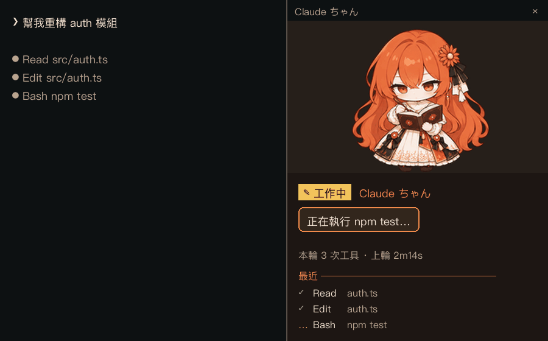
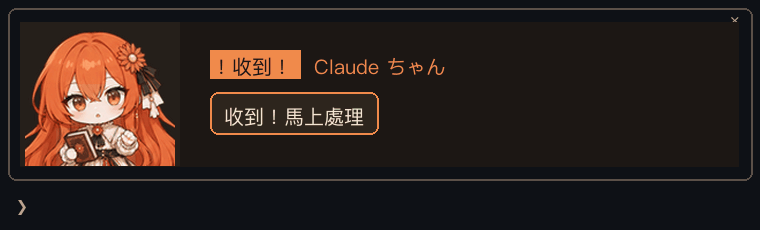
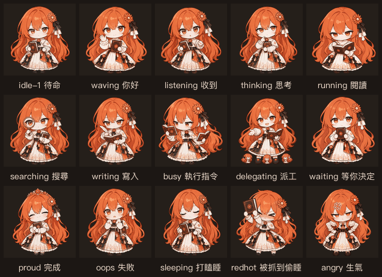

# Claude ちゃん・終端機陪伴（chibi-companion）

**目前版本：0.3.3**（2026-11-03）

讓 Q 版 Claude ちゃん住進 Claude Code 的終端機介面。她會依 Claude 正在做的事切換 9 種動畫：讀檔、改檔、等你核准、出錯、完成……點她的圖還會有反應，點太快會生氣。
寬螢幕時她坐在右側面板，窄螢幕時改站在輸入框上方。

<p align="center">
  <br>
  <sub>寬螢幕：停靠在對話右側的面板（示意圖）</sub>
</p>

<p align="center">
  <br>
  <sub>窄螢幕：輸入框上方的面板，只畫上半身（示意圖）</sub>
</p>

<details>
<summary><b>9 種動畫一覽</b></summary>

<p align="center"></p>

</details>

> 以上為依 mod 的版面與配色繪製的示意圖（原圖模式），實際外觀依終端機與視窗大小而定。

圖像使用 Codex 寵物的兩組精靈圖（流暢版 / 經典版），有兩種繪製方式，會自動選擇：

| 繪製方式 | 終端機 | 畫質 |
|---|---|---|
| **原圖**（Image） | Ghostty、kitty、iTerm2 3.5+ | 原始 PNG 像素，最清楚 |
| **字元畫**（Raster） | 其他支援真彩色的終端機（Warp、Windows Terminal、WezTerm…） | 每格用四分塊字元 `▘▝▖▗▚▞…` 表現 2×2 像素，無法避免失真 |

---

## 需求

| 項目 | 說明 |
|---|---|
| Claude Code | 支援 mods（function hooks）的版本；本 mod 以 2.1.316 開發與測試 |
| 終端機 | 支援 24-bit 真彩色（Warp、Windows Terminal、iTerm2、WezTerm、Ghostty、kitty 等） |
| 字型 | 能正常顯示四分塊字元 `▘▝▖▗▚▞▛▜▙▟`（Menlo、SF Mono、Cascadia、JetBrains Mono 等都可以） |
| 作業系統 | Windows / macOS / Linux（安裝腳本分別為 `install.ps1` / `install.sh`） |

目標裝置**不需要** Python 或 Node；動畫幀已預先轉好，字元畫在 `plugin/hooks/frames-*.ts`，原圖在 `plugin/assets/`。

---

## 安裝

### 從 GitHub 安裝（最簡單）

在 Claude Code 的提示列輸入：

```
/plugin install chibi-companion --marketplace kzger/chibi-companion
```

或在 shell 裡：

```bash
claude plugin install chibi-companion --marketplace kzger/chibi-companion
```

出現 `Add marketplace?` 時按 `y`，選 user scope 後按 Enter 即可。桌面版 App（`/plugin` 不能用時）：點提示框旁的 **+** → Plugins → Add marketplace，輸入 `kzger/chibi-companion`，再 Add plugin。

#### 更新到 GitHub 上的新版

```bash
claude plugin marketplace update chibi-local
claude plugin update chibi-companion@chibi-local
```

然後在**正在執行的** Claude Code 裡輸入 `/reload-plugins`。

> `/exit` 再開 `claude` 不一定會重新載入：Claude Code 若以背景常駐（daemon）方式執行，重開只是 `claude attach` 回到同一個程序，記憶體裡仍是舊版 mod。`/reload-plugins` 一定有效。

### 從本機資料夾安裝

### Windows

```powershell
cd <本資料夾>
powershell -ExecutionPolicy Bypass -File .\install.ps1
```

### macOS / Linux / WSL

```bash
cd <本資料夾>
bash install.sh
```

（用 zip 搬過來的檔案可能會失去執行權限，所以用 `bash install.sh` 執行最保險。）

安裝腳本會做三件事：

1. 把 `.claude-plugin/`、`plugin/`、README、ATTRIBUTION 複製到 `~/.claude/local-marketplaces/chibi-companion/`
2. 以這個資料夾註冊本機 marketplace `chibi-local`
3. 執行 `claude plugin install chibi-companion@chibi-local`（預設 `user` scope，所有專案都會出現）

完成後重新啟動 `claude` 即可看到她。

| 參數 | PowerShell | Bash |
|---|---|---|
| 只裝在目前專案 | `-Scope project` | `--scope project` |
| 移除 | `-Uninstall` | `--uninstall` |
| 更新 | 再執行一次安裝腳本，然後在 Claude Code 內 `/reload-plugins` | 同左 |

### 不想跑腳本？手動安裝

```bash
claude plugin marketplace add <本資料夾的絕對路徑>
claude plugin install chibi-companion@chibi-local
```

> 這種方式直接讀本資料夾，資料夾不能刪或搬走。

---

## 移植到其他裝置

1. 複製整個 `claude-chibi-cli` 資料夾（或壓縮成 zip 帶走）。`tools/` 可以不帶，只有重新產生動畫幀時才需要。
2. 在新裝置上照「安裝」執行對應腳本。
3. 設定（顯示方式、圖庫）存在各裝置自己的 Claude Code store，不會跟著搬，需要時再用 `/chibi` 設定一次。

---

## macOS

### 安裝步驟

1. 安裝 Claude Code（已安裝可略過）：`curl -fsSL https://claude.ai/install.sh | bash`，或 `npm install -g @anthropic-ai/claude-code`
2. 把 `claude-chibi-cli` 資料夾複製到 Mac，例如 `~/claude-chibi-cli`
3. 執行安裝：
   ```bash
   cd ~/claude-chibi-cli
   bash install.sh
   ```
4. 用推薦的終端機打開 `claude`。看到原圖代表圖片模式正常；`/chibi` 會顯示目前用的是「原圖」還是「字元」。

macOS 第一次執行從其他電腦帶來的檔案，若出現「無法驗證開發者」，執行 `xattr -dr com.apple.quarantine ~/claude-chibi-cli` 即可。

### 推薦終端機

| 終端機 | 繪製方式 | 建議 |
|---|---|---|
| **Ghostty**（https://ghostty.org） | 原圖（kitty 圖片協定） | **首選**。免費、快，原生支援，不用設定 |
| **kitty**（https://sw.kovidgoyal.net/kitty） | 原圖 | 很好，設定都寫在設定檔裡 |
| **iTerm2 3.5+** | 原圖（需要 Claude Code 的 fullscreen 模式，預設就是） | 可用。若只看到空白，執行 `/chibi render cells` |
| WezTerm、Warp | 字元畫 | 可用，但畫質跟 Windows 上一樣 |
| Alacritty | 字元畫 | 可用。Alacritty 不支援任何圖片協定，無法顯示原圖；建議執行一次 `/chibi render cells`，省掉每次啟動時的偵測空白。想要原圖可改用 Ghostty（同樣是 GPU 加速、設定檔驅動，習慣最接近） |
| 內建「終端機」Terminal.app | 字元畫 | 不建議：舊版不支援 24-bit 真彩色，顏色會跑掉 |

### 切換原圖／字元畫

| 指令 | 效果 |
|---|---|
| `/chibi render auto` | 預設。能畫原圖就用原圖，不支援時自動改字元畫 |
| `/chibi render image` | 強制原圖 |
| `/chibi render cells` | 強制字元畫（Alacritty 建議設這個，省掉啟動時的偵測空白） |

輸入 `/chibi` 可看目前實際狀態，例如「目前畫面 — 面板：原圖，上方列：原圖」。設定會記住，下次啟動沿用。

### Ghostty + tmux（macOS）

tmux 只是把圖片「轉交」給外層終端機，外層終端機本身要能畫圖才行：

| 組合 | 原圖 |
|---|---|
| Alacritty + tmux | ✗ 不行（Alacritty 不支援圖片），只能用字元畫 |
| Ghostty + tmux | ✓ 可以，照下面設定 |
| Ghostty（不用 tmux） | ✓ 可以，不用設定 |

**1. 安裝**

```bash
brew install --cask ghostty
brew install tmux        # 已安裝可略過；需要 tmux 3.3 以上（tmux -V 查版本）
```

**2. 編輯 `~/.tmux.conf`，加上：**

```tmux
# 讓 Claude Code 的圖片穿過 tmux，交給 Ghostty 繪製（原圖模式必需）
set -g allow-passthrough on
set -g focus-events on

# 真彩色（字元畫模式的顏色正確需要）
set -g default-terminal "tmux-256color"
set -as terminal-features ",xterm-ghostty:RGB"
```

**3. 讓設定生效**：舊的 tmux server 不會讀新設定，要整個重開：

```bash
tmux kill-server   # 會關閉所有 tmux session，先存好工作
tmux
```

**4. 確認**：在 tmux 裡啟動 `claude`，輸入 `/chibi`，看到「面板：原圖」即成功。若是「字元」：

- `tmux show -g allow-passthrough` 應顯示 `on`
- `tmux -V` 應為 3.3 以上
- 確認外層真的是 Ghostty（在 tmux 外執行 `echo $TERM_PROGRAM` 應顯示 `ghostty`）

### 從 Alacritty + tmux 換到 Ghostty

tmux 的 session、detach、快捷鍵、`.tmux.conf` 全部照舊沿用，只換外層終端機，再加上第 2 步的設定即可。

不想用 tmux 的話，Ghostty 本身也能分割視窗：

| 動作 | Ghostty 快捷鍵 |
|---|---|
| 左右分割 | `Cmd+D` |
| 上下分割 | `Cmd+Shift+D` |
| 切換上一個／下一個分割 | `Cmd+[` ／ `Cmd+]` |
| 關閉目前分割 | `Cmd+W` |

差別：Ghostty 的分割沒有 tmux 的 **detach**（關掉視窗程式就結束，不能放在背景之後再接回，也不能透過 SSH 接回同一個 session）。習慣 tmux 的話，建議 **Ghostty + tmux**。

### tmux 裡顏色偏灰、看不到右側面板

Claude Code 偵測到 tmux 時會做兩件事——把顏色降成 256 色（暖棕色背景變成灰色），以及改用一般（非 fullscreen）畫面，這時面板無法停靠在右側，只能放在輸入框上方。在 `~/.claude/settings.json` 加上下面的 `env`，然後重開 `claude`：

```json
{
  "env": {
    "CLAUDE_CODE_TMUX_TRUECOLOR": "1",
    "CLAUDE_CODE_NO_FLICKER": "1"
  }
}
```

前提是 tmux 本身已開真彩色（`set -ag terminal-overrides ",xterm-256color:RGB"`）。只想切換畫面模式也可以執行 `/tui fullscreen`。`/chibi` 偵測到這兩種情況時會提示。

### tmux 裡動畫時游標狂閃、輸入法組字跟著閃

Claude Code 每畫一幀都用「同步更新」包起來（先藏游標、畫圖、再把游標放回輸入框），終端機一次畫完就看不到游標移動。但 tmux 只有在知道外層終端機支援同步更新時才會照做，否則游標的每一步移動都會被畫出來。在 tmux 設定加上（Alacritty 0.13+、Ghostty、kitty、WezTerm、iTerm2 都支援）：

```
set -as terminal-features ",xterm-256color:sync"
```

tmux 是在連線時決定外層終端機的功能，所以要 detach（`prefix` `d`）再 `tmux attach`，或 `tmux kill-server` 重開。用 `tmux display -p '#{client_termfeatures}'` 確認清單裡有 `sync`。

另外需要 **tmux server 3.8 以上**：3.7 以前的 tmux 自己重畫時，會在同步區塊之外先隱藏游標，所以就算有 `sync` 還是會閃。注意升級 tmux 後，舊的 server 會繼續執行舊版，要 `tmux kill-server` 重開才會換成新版。用 `tmux display -p '#{version}'` 看的是 **server** 的版本（`tmux -V` 只是程式本身的版本）。

### herdr（取代 tmux）

[herdr](https://herdr.dev) 是專為 coding agent 設計的終端機多工器，跟 tmux 一樣能分割視窗、在背景保留 session。它自己解讀 Kitty 圖片協定再交給外層終端機，所以原圖模式**不會有 tmux 那種換圖時的閃爍**。

但 Claude Code 在 herdr 裡偵測不到圖片支援（herdr 回報的終端機名稱是 `libghostty`，Claude Code 只認得 `kitty` / `ghostty`），會改用字元畫。要顯示原圖，在 `~/.zshrc` 加上：

```zsh
# Claude Code cannot detect image support inside herdr (it reports "libghostty"),
# but herdr renders Kitty graphics: let Claude Code draw pictures there only.
if [[ "$TERM_PROGRAM" == "herdr" ]]; then
  export CLAUDE_CODE_FORCE_TERMINAL_IMAGES=1
fi
```

- 只在 herdr 的 pane 裡生效（herdr 會設 `TERM_PROGRAM=herdr`）。**不要**把這個變數寫進 `settings.json`：在不支援圖片的終端機或 tmux 裡，她會變成一塊空白，而且不會自動退回字元畫。
- 外層終端機要能畫圖（Ghostty、kitty 等）。
- 加完後要開**新的** pane，或在現有 pane 執行 `exec zsh`：herdr 的背景服務會保留 pane，重開 herdr 時舊 pane 帶的是舊環境。
- 確認：`echo $CLAUDE_CODE_FORCE_TERMINAL_IMAGES` 顯示 `1`，在 Claude Code 執行 `/chibi render auto` 後，`/chibi` 顯示「面板：原圖」。

---

## 使用

| 指令 | 作用 |
|---|---|
| `/chibi` | 顯示目前設定與說明 |
| `/chibi auto` | **預設**。寬螢幕（fullscreen 且 ≥110 欄）停靠在右側；窄螢幕改成框在輸入框上方的面板。窄螢幕剛啟動時 Claude Code 不讓面板自己放上，會先用上方列，你送出第一則訊息後換成面板 |
| `/chibi pane` | 強制開面板（手動開啟時任何寬度都可以） |
| `/chibi band` | 一律放在輸入框上方，不停靠右側。窄螢幕（不到 110 欄，或非 fullscreen）用跟 `auto` 一樣、右上角有 × 的框；寬螢幕 Claude Code 會把面板停靠右側，所以改用上方列（有外框，右側是 Claude Code 自帶的 `[-]`）。剛啟動或視窗剛變窄時也會先用上方列，送出下一則訊息後換成有 × 的框 |
| `/chibi off` | 不畫圖，只在狀態列顯示文字 |
| `/chibi set smooth` | 流暢版圖庫（預設，相鄰幀差異小，縮小後較不閃爍） |
| `/chibi set classic` | 經典版圖庫（表情較生動，例如揮手時張嘴笑） |
| `/chibi render auto` | **預設**。能畫原圖就用原圖，終端機不支援時自動改成字元畫 |
| `/chibi render image` | 強制原圖 |
| `/chibi render cells` | 強制字元畫 |

設定會記住，下次啟動沿用。

### 畫面配置

**寬螢幕**：右側面板（fullscreen 模式下停靠在對話旁）

```
┌─ chat ───────────────────────────┬─ Claude ちゃん ──────────────────┐
│ > 幫我重構 auth 模組               │       (動畫 34×18 格)        │
│ ● Read src/auth.ts               │                              │
│ ● Edit src/auth.ts               │ ✎ 工作中                      │
│                                  │ 正在改 auth.ts…               │
│                                  │ 本輪 7 次工具 · 上輪 2m14s     │
│                                  │ ── 最近 ──                    │
│                                  │ ✓ Read auth.ts               │
│                                  │ ✗ Bash npm test              │
```

**窄螢幕**：框在輸入框上方的面板（右上角有 ×；原圖最多 9 行含外框）

```
│  (動畫 22×12)   ╭──────────────────────────╮
│  工作時偶爾會    │ ✎ 工作中                  │
│  在這排走來走去   │ 正在改 auth.ts…           │
│                 ╰──────────────────────────╯
│ > _
```

- 上方列空間小，只畫她的上半身（頭到肩膀），臉部比較清楚；側面板畫全身。
- **原圖模式下大小會跟著視窗變**：側面板最多佔面板寬度的 60%、高度的 40%；上方列約佔終端機高度的 30%，含外框最多 9 行。字元畫模式只有固定兩種尺寸（全身 34×18、半身 22×12），依空間擇一。
- 圖片是原始 PNG 放大顯示，放得越大會越柔和（不會更清楚）。
- 上方列會一直顯示。右側的 `[-]` 是 Claude Code 自帶的收合按鈕（mod 無法移除），按下或 `Ctrl+X Ctrl+A` 會收合，再按一次展開。
- 動畫每次重畫至少間隔 240ms（較快的動作改用跳幀，速度不變）。
- 動畫時游標或輸入法組字一直閃：終端機沒有開「同步更新」（synchronized output）。tmux 裡尤其常見，見 macOS 的 tmux 說明。
- 上方列空間不夠時：原圖模式剩 2～6 行會改成「迷你版」（縮小的頭像加一行狀態）；再更少，或字元畫不足 14 行（12 行加外框）時，退回一行文字：`✎ Claude ちゃん · 工作中 正在改 auth.ts…`。
- 上方列能用的高度由 Claude Code 決定（大約是畫面下半部扣掉輸入框與狀態列）。狀態列很高（例如多行的 claude-hud）或 tmux 分割得很小時，空間會很少。
- 非 fullscreen 的終端機上，面板會放在輸入框上方，並自動改用精簡排版。

### 為什麼寬螢幕的上方列沒有 ×

有 × 的框是「面板」的外框，輸入框上方列右側的 `[-]` 則是上方列的收合鈕，兩者都由 Claude Code 繪製，mod 只能畫框裡的內容：

- 面板放在哪裡由 Claude Code 決定：fullscreen 且終端機 ≥110 欄時一律停靠右側，否則放在輸入框上方。mod 無法指定位置，把 mod 畫得再寬也一樣。
- 上方列一定帶 `[-]`，mod 無法移除。

所以在寬的 fullscreen 畫面，「停靠右側」與「上方有 × 的框」只能二選一。`"CLAUDE_CODE_NO_FLICKER": "0"`（非 fullscreen）會讓面板在任何寬度都放在輸入框上方，但就不能停靠右側了。本 mod 的做法是：寬螢幕 `/chibi band` 用有外框的上方列，窄螢幕改開有 × 的面板。

### 配色

取自角色本身的顏色（髮色橘、奶油色洋裝、棕色書本），面板與上方列自帶背景色，深色或淺色的終端機主題看起來都一樣。所有文字與背景的對比度都在 5.5:1 以上（WCAG AA），狀態一律用「圖示＋文字」標示，不只靠顏色區分。

| 用途 | 色碼 |
|---|---|
| 面板背景 | `#1C1714` |
| 角色舞台 | `#26201B` |
| 對話泡泡（橘色圓角框） | `#33261E`，邊框 `#F08A4B` |
| 主要文字／次要文字 | `#F3E5D3` ／ `#B9A48F` |
| 狀態標籤：工作中／等待／出錯／完成／待機 | `#F2C35B` ／ `#8FC1E3` ／ `#F07E6E` ／ `#9CC98A` ／ `#B9A48F` |

要改顏色，修改 `plugin/hooks/register.tsx` 開頭的 `THEME`。

### 事件與動畫

| 動畫 | 何時出現 | 播放方式 |
|---|---|---|
| `waving` 揮手 | 開啟 session | 播三輪 |
| `jumping` 點頭眨眼 | 你送出 prompt（「收到！」） | 播三輪 |
| `running` 寫作 | 這一輪正在進行 | 持續 |
| `waiting` 等待 | 權限確認、AskUserQuestion、計畫核准 | 持續到你回應 |
| `failed` 失敗 | 工具出錯或被拒絕、你中斷、API 錯誤 | 播三輪 |
| `review` 閱讀 | 這一輪完成 | 播三輪 |
| `idle` 待機 | 沒事時；閒置 20 秒後停在閉眼幀打瞌睡 | 持續 |
| `running-left/right` | 工作超過 40 秒時，在上方列左右走一趟 | 一趟 |
| `angry` 生氣 | 4 秒內點她 3 次（生氣時再點會更久）；第 2 次會先警告「別一直戳啦」 | 播三輪 |

**點她的圖**：每點一次依序換一種反應與台詞（揮手、點頭、閱讀、寫作、等待），約 1.5 秒後回到原本的動作與台詞；打瞌睡時點她會馬上醒來。只有「等你決定」（權限確認等）時不會被打斷。點擊靠的是疊在圖上的透明區域，需要終端機支援滑鼠回報（Ghostty、kitty、iTerm2、WezTerm 等都可以）。

`angry` 的原圖是 `tools/build_angry.py` 用叉腰的姿勢圖 `tools/assets/angry-pose.png`（以原角色為參考另外生成）做成的：往前傾兩次，頭上的 Twemoji 💢（CC BY 4.0，署名見 `plugin/ATTRIBUTION.txt`）一跳一跳。字元畫模式沒有這組幀，生氣時改畫 `failed`。

同時符合多個狀態時，顯示哪一個由 `plugin/hooks/mood.ts` 的 `pickState()` 決定。

---

## 自訂

| 想改什麼 | 檔案 |
|---|---|
| 狀態優先順序 | `plugin/hooks/mood.ts` → `pickState()` |
| 對話泡泡文字、各工具的描述 | `plugin/hooks/register.tsx` → `describeTool()`、`TITLE` |
| 收起、打瞌睡、散步的時間 | `plugin/hooks/register.tsx` 開頭的常數 |
| 點擊的反應、台詞、生氣的門檻 | `plugin/hooks/register.tsx` → `POKES`、`ANGRY_LINES`、`POKE_ANGRY_AT`、`POKE_WINDOW_MS` |
| 生氣動畫的 💢 位置、大小、前傾與跺腳 | `tools/build_angry.py`，改完執行 `uv run --with pillow --with numpy python tools/build_angry.py` |
| 動畫尺寸、色數、換圖庫 | `tools/build_frames.py` 的 `SIZES`（字元畫）、`IMAGE_ROWS`（原圖）、`CROP`（上方列的上半身裁切），改完重新產生 |
| 配色 | `plugin/hooks/register.tsx` 的 `THEME` |

重新產生 README 的示意圖（需要 Python 3 + Pillow，以及含繁中與日文假名的字型，macOS 內建的 PingFang 即可）：

```bash
python tools/make_readme_images.py            # 寫到 docs/images/
```

重新產生動畫幀（需要 Python 3 + Pillow + NumPy）：

```bash
# 兩組 Codex v1 精靈圖（1536×1872，8×9 格，每格 192×208）
python tools/build_frames.py --smooth path/to/smooth.png --classic path/to/classic.png
# build_frames.py 會清空 plugin/assets/<set>/，之後要重新產生生氣的幀
python tools/build_angry.py
```

修改後的檢查：

```bash
claude plugin validate plugin     # 檢查 manifest 與 hooks
claude plugin test plugin         # 執行 plugin/tests 的繪製測試
```

---

## 疑難排解

| 狀況 | 處理 |
|---|---|
| 完全沒出現 | `claude plugin list` 確認 `chibi-companion@chibi-local` 已啟用；用 `claude --debug` 啟動，搜尋 `chibi-companion` |
| 面板沒開 | 終端機寬度不到 144 欄時，自動模式不會開面板，會改用上方列；可用 `/chibi pane` 強制開啟 |
| 面板只出現在輸入框上方、不在右側 | 不是 fullscreen 畫面（tmux 預設如此）：執行 `/tui fullscreen`，或設定 `CLAUDE_CODE_NO_FLICKER=1`（見 macOS 的 tmux 說明） |
| 動畫時游標一直閃、輸入法組字跟著閃 | tmux 沒開同步更新，或 tmux server 早於 3.8：加 `set -as terminal-features ",xterm-256color:sync"`，並確認 `tmux display -p '#{version}'` ≥ 3.8，否則 `tmux kill-server` 重開（見 macOS 的 tmux 說明） |
| herdr 裡只有字元畫、沒有原圖 | Claude Code 偵測不到 herdr 的圖片支援：見 macOS 的 herdr 說明，設定 `CLAUDE_CODE_FORCE_TERMINAL_IMAGES` |
| tmux 裡原圖模式偶爾閃一下 | Claude Code 在 tmux 裡每一幀都用同一個圖片 id、分段重傳整張 PNG，這些資料經 tmux 直接轉給終端機、不在同步更新內，換圖途中可能短暫空白。不在 tmux 裡執行 `claude`（直接用 Ghostty，或改用 herdr）可避免；或改用 `/chibi render cells` |
| tmux 裡配色偏灰、跟其他終端機差很多 | Claude Code 在 tmux 裡只用 256 色：設定 `CLAUDE_CODE_TMUX_TRUECOLOR=1`（見 macOS 的 tmux 說明） |
| Mac 上只看到空白、沒有圖 | 終端機不支援圖片，或 tmux 沒設定 passthrough；執行 `/chibi render cells` 改用字元畫，或換 Ghostty |
| 圖案有細縫或格線 | 終端機用字型畫方塊字元而不是自己繪製；換字型，或調整行距為 1.0 |
| 顏色怪、出現色塊 | 終端機沒開真彩色；tmux 使用者見上方「Ghostty + tmux」第 2 步的真彩色設定 |
| 圖案比例扁或長 | 字型行高不是 1:2；換一個等寬字型，或把行距設回 1.0 |
| 想暫時關掉 | `/chibi off`，或 `claude plugin disable chibi-companion@chibi-local` |

---

## 檔案結構

```
claude-chibi-cli/
├─ .claude-plugin/marketplace.json   本機 marketplace（chibi-local）
├─ plugin/                           mod 本體（chibi-companion）
│  ├─ .claude-plugin/plugin.json
│  ├─ hooks/hooks.json
│  ├─ hooks/register.tsx             事件、狀態機、面板與上方列的繪製
│  ├─ hooks/mood.ts                  pickState()：狀態優先順序
│  ├─ hooks/sprite.ts                幀解碼 → Raster 四分塊字元
│  ├─ hooks/frames-smooth.ts         流暢版字元畫動畫幀（自動產生）
│  ├─ hooks/frames-classic.ts        經典版字元畫動畫幀（自動產生）
│  ├─ assets/<圖庫>/<動作>/<n>.png    原圖動畫幀，全身（自動產生）
│  ├─ assets/<圖庫>/<動作>/<n>-bust.png  原圖動畫幀，上半身（上方列用）
│  ├─ types/index.d.ts               $.state 型別契約
│  └─ tests/render.test.tsx          繪製測試
├─ tools/build_frames.py             精靈圖 → 動畫幀轉換
├─ tools/make_readme_images.py       README 示意圖產生器
├─ docs/images/                      README 的示意 GIF
├─ install.ps1 / install.sh          安裝、更新、移除
├─ ATTRIBUTION.txt                   素材來源與授權
└─ README.md
```

---

## 授權

角色原畫：CrossPet（lokicorvus），**CC BY-NC-SA 4.0**。本 mod 的動畫幀為改作，沿用相同授權：須保留署名、限非商業用途、以相同授權分享。詳見 `ATTRIBUTION.txt`。
